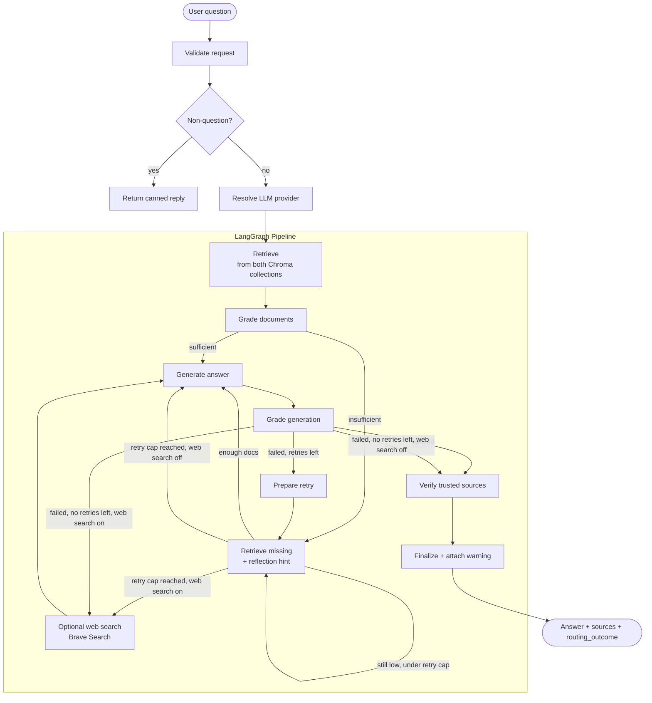
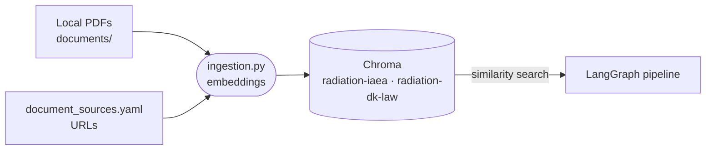

# Radiation Safety RAG


[](https://github.com/eikrad/Radiationsafety/actions/workflows/ci.yml)

Ask questions about IAEA nuclear safety standards and Danish radiation legislation in plain language. The system retrieves the most relevant chunks from a local vector database, grades them, generates a grounded answer, and flags anything it cannot verify.

## Features

- **RAG over IAEA and Danish sources** — covers IAEA GSR, SSG, SSR, TECDOC standards and Danish Bekendtgørelser
- **Multi-provider LLM** — Scaleway (EU-hosted, default), Gemini, OpenAI, Mistral, or fully-local Ollama (privacy mode, zero data leaves your machine)
- **Grounded answers** — every answer is verified against retrieved source documents; unverified web results are flagged
- **Optional web search fallback** — off by default; with `WEB_SEARCH_ENABLED=true` and a Brave Search key it fills gaps the local documents leave, and the answer is still checked against trusted sources (never used in privacy mode)
- **Document management UI** — check for updated versions of source documents and re-ingest from the browser
- **Docker-ready** — compose setup with persistent Chroma volume; run ingestion once and you're done
- **Evaluation harness** — golden questions with expected facts and source passages, an independent LLM judge, deterministic retrieval metrics, run history and a local dashboard

## How it works



See [docs/architecture.md](docs/architecture.md) for a full walkthrough of every node, chain, ingestion workflow, and API routes.

## Tech Stack

| Layer | Technology |
|-------|------------|
| Backend API | FastAPI + Python |
| AI pipeline | LangGraph + LangChain |
| Embeddings | Scaleway `bge-multilingual-gemma2` (default) or Google Gemini (`EMBEDDING_PROVIDER`); local Ollama in privacy mode |
| LLM for answers | Scaleway (default, Gemma 4) / Gemini / OpenAI / Mistral / Ollama (configurable via `LLM_PROVIDER`) |
| Vector database | Chroma |
| Document processing | Docling HybridChunker |
| Frontend | React + TypeScript (Vite) |
| Container | Docker + Docker Compose |

## Documentation

| File | What it covers |
|------|----------------|
| [docs/README.md](docs/README.md) | Index of all documentation |
| [docs/architecture.md](docs/architecture.md) | Pipeline nodes, chains, ingestion workflow, LLM providers, API routes — with Mermaid diagrams |
| [docs/production-readiness.md](docs/production-readiness.md) | Security, admin auth, rate limiting, container hardening, and runbook |
| [docs/maintenance.md](docs/maintenance.md) | Dated log of dependency checks and upgrade notes |
| [docs/releasing.md](docs/releasing.md) | How versions, tags and the CHANGELOG are produced |
| [eval/README.md](eval/README.md) | Evaluation harness |

## Ingestion overview

Documents are embedded once into a local Chroma database. The same vector store is reused for all queries — changing which LLM generates answers does **not** require re-ingestion.



Ingestion needs the key of the embedding provider (`SCW_SECRET_KEY` by default). See [docs/architecture.md](docs/architecture.md) for the full ingestion and document-update workflow.

## Running with Docker

The image does not ship the vector DB (`.chroma` is too large for the repo). The backend
mounts the project's `.chroma/` directory, so Docker and local runs share one index.

1. Copy `.env.example` to `.env`. Set **`SCW_SECRET_KEY`** (Scaleway: default for answers and embeddings). Optionally set another `LLM_PROVIDER` and its key for generation (`GOOGLE_API_KEY`, `MISTRAL_API_KEY`, or `OPENAI_API_KEY`).
2. Start the stack:
   ```bash
   docker compose up --build
   ```
3. If `.chroma/` is empty, build the index once, either locally (`uv run python ingestion.py`) or in the container:
   ```bash
   docker compose run --rm backend python ingestion.py
   ```
   Both write to `.chroma/` on the host. After a local ingestion, run `docker compose restart backend` so the running container picks it up. Do not ingest locally while the container is writing to the index.
4. Open **http://localhost:8080** for the UI. The frontend proxies `/api` to the backend. Settings show per provider whether its search index is built.

Rebuilding the images (`--build`) never touches the index. Changing `LLM_PROVIDER` does not require re-ingestion.

**On a server:** `.chroma/` is not in git, so a fresh clone starts without an index. Copy yours (`rsync -a .chroma/ server:path/to/Radiationsafety/.chroma/`, no API cost) or run the ingestion there. You do not need to create the directory or fix its owner: a one-shot `chroma-permissions` service hands it to the backend's uid 1000 before the backend starts (only that short-lived container gets root and `CHOWN`). If your user on the server is not uid 1000, the files then belong to uid 1000, so ingest in the container rather than with `uv run` there. To keep the index elsewhere, set `CHROMA_DIR=/srv/radiationsafety/chroma` in `.env`. The embedding settings on the server (`EMBEDDING_PROVIDER`, `SCW_EMBED_MODEL`) must match collections in the copied index.

## Setup (local)

1. Copy `.env.example` to `.env` and configure:
   - **`SCW_SECRET_KEY`** — Scaleway, the default for answers (`SCW_MODEL`) and embeddings (`SCW_EMBED_MODEL`); `.env.example` sets the measured defaults
   - **`LLM_PROVIDER`** — `scaleway` (default), `gemini`, `openai`, `mistral`, or `ollama`; set the matching API key
   - **`EMBEDDING_PROVIDER`** — `scaleway` (default) or `gemini` (`GOOGLE_API_KEY`); independent of the answering model
   - Optional: `WEB_SEARCH_ENABLED=true` + `BRAVE_SEARCH_API_KEY` for web search fallback
   - Optional: `LANGCHAIN_API_KEY` for LangSmith tracing

2. Install dependencies:
   ```bash
   uv sync
   ```

3. Run ingestion (one-time; uses the configured embedding provider):
   ```bash
   uv run python ingestion.py
   ```
   Changing `LLM_PROVIDER` later does **not** require re-running ingestion — retrieval uses the embeddings chosen by `EMBEDDING_PROVIDER` (default Scaleway) regardless of which model generates answers.

   To switch embeddings (e.g. from Gemini to Scaleway), embed the existing chunks again without re-parsing the documents:
   ```bash
   EMBEDDING_PROVIDER=scaleway uv run python ingestion.py --reembed-from gemini
   ```
   Each embedding model gets its own collections (`radiation-iaea-scw-<model>`, …), so switching back needs no rebuild.

   Danish orders are read from retsinformation.dk XML (the sources in `document_sources.yaml`, kept current by the update check). A PDF of the same order in `documents/Bekendtgørelse/` is skipped, so each law is indexed once and an old PDF cannot sit next to a newer version; other PDFs there (e.g. SST guidance) are still read. If retsinformation.dk cannot deliver an order, the XML saved by its last fetch (`<id>_current.xml`) is indexed instead, so the PDF stays skipped. To rebuild only the Danish collection, e.g. after an update:
   ```bash
   uv run python ingestion.py --dk-only
   ```

   PDFs are read with docling (layout and OCR). If docling fails on its default device, for example because a local model fills the GPU, it reads the PDF again on the CPU, which is slower (`DOCLING_DEVICE=cpu uv run python ingestion.py` uses the CPU from the start). If docling cannot read a PDF on the CPU either, ingestion stops and names the file and the error before any collection is emptied. Pass `--allow-pypdf-fallback` to index that PDF as plain text instead (a scanned PDF then gives no text). The run ends with a list of every PDF that was not read as usual: read on the CPU, read as plain text, skipped, or with almost no text (fewer than 100 characters per page, likely a scan without OCR); and every source in `document_sources.yaml` that could not be fetched, with the reason. A PDF uploaded in the Documents panel reports the same in its message, and an ingestion started there shows that list, or why it failed, in the panel.

4. Start the backend:
   ```bash
   uv run uvicorn api.main:app --reload --port 8000
   ```

5. Start the frontend (choose one):
   - **Single server**: `npm -C frontend run build` then open http://localhost:8000
   - **Dev mode** (hot reload): `npm -C frontend install && npm -C frontend run dev` → http://localhost:5173

6. Optional CLI:
   ```bash
   uv run python main.py
   ```

### Document sources

Copy `document_sources.example.yaml` to `document_sources.yaml` to register source URLs for automatic fetching and update checking. Or build the registry from local PDFs already in `documents/`:

```bash
uv run python build_document_sources.py
```

The **Documents** panel in the UI lets you check for newer versions (retsinformation.dk, IAEA) and trigger re-ingestion without leaving the browser. Danish sources are always fetched as the newest version of the series; older versions are backed up to `documents/backup/Bekendtgørelse/`.

An IAEA source whose PDF (its `filename_hint`) is in `documents/IAEA/` or `documents/IAEA_other/` is indexed from that file and not fetched again during ingestion, so each publication is indexed once. A new edition has its own publication page, which only the update check finds; downloading it replaces the local PDF and keeps the old one in `documents/backup/`. Only an IAEA source without a local PDF is fetched from its URL.

## Privacy Mode (Fully Local)

All LLM generation and embeddings run locally via [Ollama](https://ollama.com). Zero data leaves your machine — LangSmith tracing and web search are automatically disabled.

### Answer quality

The default local model (`gemma4:e4b-it-qat`) is much smaller than the hosted default, and its answers are measurably weaker. On the 53 held-out `confirm` questions it passed 32 (60 %, 95 % interval 47–72 %) against 44 (83 %, 71–91 %) for Gemma 4 26B on Scaleway, under both judges (net −12 questions, sign test p ≤ 0.008). It finds the right passages but more often attributes them to the wrong provision or misreads tables. The gap is model size, not local hosting: the 26B model is open weights too and was within the noise of Gemini 3.8 Flash on the same questions. The app shows a notice while the local model is selected. Details: `ROADMAP.md`, "Local model for privacy mode".

### Minimum system requirements

| Component | Minimum | Recommended |
|-----------|---------|-------------|
| GPU | 4 GB VRAM (CPU fallback works but slow) | 6 GB+ VRAM (e.g. NVIDIA RTX 3060) |
| RAM | 16 GB | 32 GB |
| Disk | ~8 GB (models + vector DB) | ~10 GB |
| OS | Linux, macOS, or Windows | Linux (best Ollama performance) |

### Setup

1. Install Ollama:
   ```bash
   curl -fsSL https://ollama.com/install.sh | sh
   ```
2. Pull models:
   ```bash
   ollama pull gemma4:e4b-it-qat
   ollama pull bge-m3
   ```
3. Set `LLM_PROVIDER=ollama` in `.env`
4. Run ingestion (one-time, builds local embedding collections):
   ```bash
   uv run python ingestion.py
   ```
5. Start backend and frontend as usual, select **Ollama (Local)** in the UI dropdown.

Local collections (`radiation-iaea-ollama-bge-m3`, `radiation-dk-law-ollama-bge-m3`) coexist with the cloud collections. Upgrading from `nomic-embed-text` (English-only, the earlier default): pull `bge-m3` and run the ingestion again, or set `OLLAMA_EMBED_MODEL=nomic-embed-text` to keep the old collections. Switching back to a cloud provider reuses the original collections without re-ingesting.

## Evaluation

The evaluation harness lives in `eval/`. It runs the RAG pipeline against a golden set of questions whose facts (nuggets) and source passages (evidence) are known, has an independent LLM judge assign the facts, scores retrieval deterministically, and records every run for a local dashboard. `--retrieval-only` compares embeddings or retrieval settings by evidence recall alone. See [eval/README.md](eval/README.md).

```bash
uv run python -m eval.run_eval
```

Run ingestion first so the graph has documents to retrieve. See `eval/README.md` for options (`--limit`, `--no-web-search`) and optional LangSmith tracing.

## Testing

CI runs the test suite on push and on pull requests (see badge above).

- **Backend**: `uv sync` (includes the dev tools) then `uv run pytest tests/ -v`
- **Frontend (unit)**: `cd frontend && npm run test` (or `npm run test:watch` for watch mode)
- **Frontend (E2E)**: `cd frontend && npx playwright install --with-deps chromium && npm run test:e2e` — UI-only Playwright tests against a mocked API (see `frontend/e2e/`)
- **Frontend (visual)**: `cd frontend && npm run test:visual:docker` — screenshot comparisons of header, settings and an answer in light and dark mode (see `frontend/visual/`). They run in the Playwright Docker image so fonts match CI; after an intended UI change, refresh the baselines with `npm run test:visual:update` and commit the new PNGs.
- **Coverage**: `uv run pytest tests/ --cov` and `cd frontend && npm run test:coverage`; CI writes both to the run summary

## Security

- Admin routes (`/ingest` and mutating `/documents/*` endpoints) require `X-Admin-Token`.
- Without `ADMIN_TOKEN` configured, admin routes are fail-closed (`503`). Set `ADMIN_AUTH_BYPASS=true` only for local-only development.
- Rate limiting is in-memory per-client by default; switch to Redis for multi-worker deployments (`RATE_LIMIT_BACKEND=redis`).

See [docs/production-readiness.md](docs/production-readiness.md) for the full runbook, rate limiting config, container hardening details, and observability setup.

## Vector collections

| Collection | Content | Embeddings |
|---|---|---|
| `radiation-iaea-scw-<model>` | IAEA standards and TECDOC documents | Scaleway (default: `bge-multilingual-gemma2`) |
| `radiation-dk-law-scw-<model>` | Danish Bekendtgørelser (retsinformation.dk XML) | Scaleway |
| `radiation-iaea` | Same content | Gemini |
| `radiation-dk-law` | Same content | Gemini |
| `radiation-iaea-ollama` | Same content | Ollama local |
| `radiation-dk-law-ollama` | Same content | Ollama local |

Cloud providers (Scaleway, Gemini, OpenAI, Mistral) all retrieve from the collections of `EMBEDDING_PROVIDER`. The LLM for generation only receives retrieved text — never the raw vectors. Switching the generation provider requires no re-ingestion.

## Contributing

Contributions are welcome. See [CONTRIBUTING.md](CONTRIBUTING.md) for dev setup, code quality checks, and the branching workflow (`feature branch → staging → master`; PRs target `staging`).

## License

Licensed under the [Apache License 2.0](LICENSE). See [NOTICE](NOTICE) for third-party attributions.

## Credits and references

This project was inspired by and draws on patterns from the **LangChain / LangGraph course** by **Eden Marco**:
- Repository: [github.com/emarco177/langchain-course](https://github.com/emarco177/langchain-course) (Apache-2.0)

We thank [Roman Kuznetsov (@kuznero)](https://github.com/kuznero) for valuable comments on the project.
