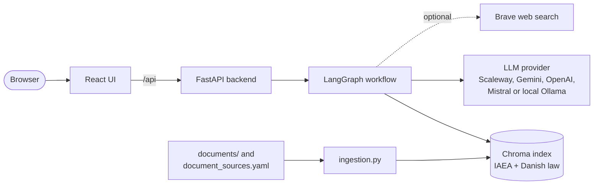
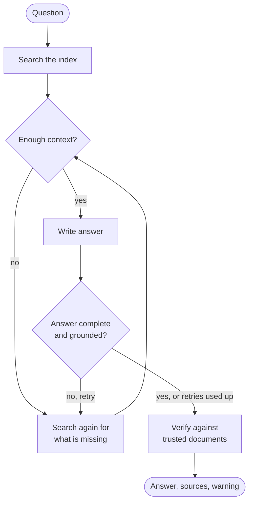

# Radiation Safety RAG


[](https://github.com/eikrad/Radiationsafety/actions/workflows/ci.yml)

Ask questions about IAEA safety standards and Danish radiation protection law in plain language (English, German or Danish). The system searches a local index of the source documents, checks whether what it found is enough, writes an answer from those passages, checks the answer again, and tells you which sources it used and whether anything could not be verified.

It is a retrieval-augmented generation (RAG) system: a FastAPI backend runs a [LangGraph](https://github.com/langchain-ai/langgraph) workflow over a [Chroma](https://www.trychroma.com/) vector index, with a React chat UI on top.

> **Status: alpha.** Answers can be wrong or incomplete. Always check the cited source before relying on an answer.

## What it covers

| Jurisdiction | Documents |
|---|---|
| **IAEA** (`documents/IAEA/`, `documents/IAEA_other/`) | General Safety Requirements GSR Parts 1–7, General Safety Guides GSG-2 and GSG-7, Specific Safety Guides SSG-11, -39, -40, -44, -46, -86, -87, Transport Regulations SSR-6, TECDOC-1380 and TECDOC-1638, Nuclear Security Series 24-G |
| **Denmark** (`documents/Bekendtgørelse/`) | Executive orders (bekendtgørelser) from retsinformation.dk on ionising radiation and radiation protection, radioactive substances, radiation generators, patient dosimetry and diagnostic reference levels, and transport of radioactive material; Danish Health Authority (SST) guidance on open radioactive sources and on safety assessments |

You can add your own PDFs through the **Documents** panel in the UI, or register further sources in `document_sources.yaml` (see [Managing documents](#managing-documents)).

## Features

- **Grounded answers with sources.** Each answer lists the documents it drew from. An answer that cannot be verified against the indexed documents carries a warning.
- **Self-correcting search.** If the retrieved passages are not enough, or the draft answer misses part of the question, the system searches the index again with a refined query before answering.
- **Choice of model.** Answers come from Scaleway (EU-hosted, default), Google Gemini, OpenAI or Mistral, selectable in the UI. You can also bring your own API key in the browser.
- **Privacy mode.** With [Ollama](https://ollama.com), answers and embeddings run entirely on your machine; no web search and no tracing.
- **Optional web search.** Off by default. When switched on (Brave Search), it is a last resort after the index searches, and the answer is still checked against the trusted documents.
- **Document management.** Check for newer versions of the sources (retsinformation.dk, IAEA), download them, upload PDFs and re-index, all from the browser.
- **Evaluation harness.** Golden questions with expected facts and source passages, an independent LLM judge, retrieval metrics, run history and a local dashboard ([eval/README.md](eval/README.md)).

## How it works



Documents are split into chunks and embedded once by `ingestion.py`. Each question then goes through this loop:



The index is searched at most three times before answering, and twice more if the answer check fails. With web search switched on, it is tried only after these searches. [docs/architecture.md](docs/architecture.md) shows the full workflow with every node and routing rule.

## Quick start

You need an API key for the default provider, [Scaleway Generative APIs](https://www.scaleway.com/en/generative-apis/) (`SCW_SECRET_KEY`), which is used both for answers and for embeddings. Other providers, or none at all with privacy mode, are covered under [Configuration](#configuration).

### 1. Configure and build the index

The search index is built on your machine with [uv](https://docs.astral.sh/uv/) (Python 3.12+), for Docker and local runs alike:

```bash
cp .env.example .env              # then set SCW_SECRET_KEY in .env
uv sync                           # install Python dependencies
uv run python ingestion.py        # one-time: read documents/, embed, write .chroma/
```

The index lives in `.chroma/`, which is not in git. Ingestion takes a while: PDFs are parsed with [Docling](https://github.com/docling-project/docling) (layout and OCR).

### 2a. Run with Docker

```bash
docker compose up --build
```

Open **http://localhost:8080**. The backend mounts the project's `.chroma/` directory, so it uses the index you just built. After rebuilding the index on the host, run `docker compose restart backend`.

The backend image contains no `documents/` folder, so build or rebuild the index from a checkout of the repository as in step 1 rather than inside the container. To run on a server, copy your `.chroma/` there (for example with `rsync`) or set `CHROMA_DIR` in `.env` to where the index lives; the embedding settings must match the copied index. Privacy mode is not set up for Docker yet ([plan](docs/privacy-mode-docker-plan.md)).

### 2b. Run locally (development)

```bash
uv run uvicorn api.main:app --reload --port 8000     # backend
npm -C frontend install && npm -C frontend run dev    # UI with hot reload
```

Open **http://localhost:5173**. Alternatively, run `npm -C frontend run build` once and the backend serves the UI at http://localhost:8000.

## Configuration

All settings are environment variables in `.env`. [`.env.example`](.env.example) lists every one with an explanation; these are the main ones:

| Variable | Purpose |
|---|---|
| `LLM_PROVIDER` | Model that writes answers: `scaleway` (default), `gemini`, `openai`, `mistral` or `ollama` (privacy mode). The UI can switch between them per question. |
| `EMBEDDING_PROVIDER` | Model that embeds documents and questions: `scaleway` (default) or `gemini`. Independent of `LLM_PROVIDER`; privacy mode always embeds locally. |
| `SCW_SECRET_KEY`, `SCW_MODEL`, `SCW_ALLOWED_MODELS`, `SCW_EMBED_MODEL` | Scaleway key, default answer model, further models offered in the UI, embedding model |
| `GOOGLE_API_KEY`, `OPENAI_API_KEY`, `MISTRAL_API_KEY` | Keys for the other providers |
| `OLLAMA_MODEL`, `OLLAMA_EMBED_MODEL`, `OLLAMA_BASE_URL` | Local models for privacy mode (defaults `gemma4:e4b-it-qat` and `bge-m3`) |
| `WEB_SEARCH_ENABLED`, `BRAVE_SEARCH_API_KEY` | Optional web search fallback (off by default) |
| `ADMIN_TOKEN` | Required for admin routes (ingestion, document changes); without it they return 503 |
| `RETRIEVER_K` | Chunks retrieved per collection per search (default 5) |
| `LANGCHAIN_TRACING_V2`, `LANGCHAIN_API_KEY` | Optional LangSmith tracing (off by default; never in privacy mode or with a user's own key) |
| `PRIVACY_CONTROLLER_NAME`, `PRIVACY_CONTROLLER_CONTACT` | Who to name in the in-app privacy notice when you run a shared instance |

Changing the answering model never requires re-indexing: all cloud providers search the index of `EMBEDDING_PROVIDER`. Changing the embedding model does, because each embedding model has its own pair of collections (see [docs/architecture.md](docs/architecture.md#key-ingestion-facts)).

## Privacy mode (fully local)

With `LLM_PROVIDER=ollama`, or **Ollama (Local)** selected in the UI, answers and embeddings are computed by [Ollama](https://ollama.com) on your machine. Nothing about the question leaves it: web search and LangSmith tracing are always off.

```bash
ollama pull gemma4:e4b-it-qat     # answer model
ollama pull bge-m3                # multilingual embeddings
LLM_PROVIDER=ollama uv run python ingestion.py   # one-time: builds the local collections
```

Then start the backend and UI as usual. The local collections sit next to the cloud ones in `.chroma/`, so you can switch back and forth without re-indexing.

The local model is much smaller than the hosted default, and its answers are measurably weaker (60 % vs. 83 % of held-out test questions answered correctly; details in [ROADMAP.md](ROADMAP.md), "Local model for privacy mode"). The UI shows a notice while it is selected.

| Component | Minimum | Recommended |
|---|---|---|
| GPU | 4 GB VRAM (CPU works, slowly) | 6 GB+ VRAM |
| RAM | 16 GB | 32 GB |
| Disk | ~8 GB (models + index) | ~10 GB |

## Managing documents

| Command | What it does |
|---|---|
| `uv run python ingestion.py` | Rebuild both collections (IAEA and Danish law) for the configured embedding model |
| `uv run python ingestion.py --dk-only` | Rebuild only the Danish law collection |
| `EMBEDDING_PROVIDER=scaleway uv run python ingestion.py --reembed-from gemini` | Embed the chunks of an existing index with another model, without parsing the documents again |
| `uv run python ingestion.py --allow-pypdf-fallback` | Index a PDF that Docling cannot read as plain text instead of stopping |
| `uv run python build_document_sources.py` | Build the source registry `document_sources.yaml` from the PDFs in `documents/` |

Ingestion reads the PDFs in `documents/` and the sources listed in `document_sources.yaml` (copy [`document_sources.example.yaml`](document_sources.example.yaml) or generate it as above). Danish executive orders are fetched as XML from retsinformation.dk, always in their newest version, and chunked along their paragraphs. At the end, ingestion lists every document it could not read normally.

In the UI, the **Documents** panel checks for newer versions, downloads them (older Danish versions are kept in `documents/backup/`), uploads PDFs and starts a re-ingestion. These actions need the admin token.

## Evaluation and tests

```bash
uv run python -m eval.run_eval          # answer the golden questions and score them
uv run pytest tests/ -v                 # backend tests
npm -C frontend run test                # frontend unit tests
```

The evaluation harness, its options and the dashboard are described in [eval/README.md](eval/README.md). Frontend end-to-end tests (`npm -C frontend run test:e2e`, mocked API) and visual tests (`npm -C frontend run test:visual:docker`) are explained in [CONTRIBUTING.md](CONTRIBUTING.md). CI runs all of them, plus linting and a Docker smoke test, on every push and pull request.

## Security

Admin routes (`/ingest` and the routes that change documents) require an `X-Admin-Token` header matching `ADMIN_TOKEN`; without `ADMIN_TOKEN` they return 503. Queries are rate-limited per client (in memory by default, Redis for several workers). See [docs/production-readiness.md](docs/production-readiness.md) before exposing the app to others.

## Project structure

```
api/                  FastAPI app: routes, admin auth, rate limiting
graph/                Question answering: the LangGraph workflow (graph.py), its nodes/ and chains/,
                      the Answerer (answering.py), model selection (llm_factory.py), the index (search_index.py)
ingestion.py          Builds the index: PDF/XML loading, chunking, embedding (+ ingestion_dk.py, ingestion_fetch.py)
document_updates.py   Checks retsinformation.dk and IAEA for newer versions
source_catalog.py     The source registry (document_sources.yaml, document_versions.json)
documents/            Source documents: IAEA/, IAEA_other/, Bekendtgørelse/
eval/                 Evaluation harness, golden questions, run history, dashboard
frontend/             React + TypeScript UI (Vite)
tests/                pytest suite
docs/                 Documentation
```

## Documentation

| Document | For |
|---|---|
| [docs/README.md](docs/README.md) | Index of all documentation |
| [docs/architecture.md](docs/architecture.md) | How a question is answered, the workflow nodes, ingestion, providers, API routes |
| [docs/production-readiness.md](docs/production-readiness.md) | Deploying and operating: auth, rate limits, metrics, container hardening, runbook |
| [CONTEXT.md](CONTEXT.md) | The project's vocabulary (question, answer, web mode, privacy mode, search index) |
| [eval/README.md](eval/README.md) | Measuring answer quality |
| [ROADMAP.md](ROADMAP.md) | Plans and measured results |

## Contributing

Contributions are welcome. See [CONTRIBUTING.md](CONTRIBUTING.md) for the development setup, code quality checks and the branching workflow: pull requests target `staging`, and commit messages follow [Conventional Commits](https://www.conventionalcommits.org/) ([docs/releasing.md](docs/releasing.md)).

## License

Licensed under the [Apache License 2.0](LICENSE). See [NOTICE](NOTICE) for third-party attributions.

## Credits

This project draws on patterns from the **LangChain / LangGraph course** by **Eden Marco** ([github.com/emarco177/langchain-course](https://github.com/emarco177/langchain-course), Apache-2.0).

We thank [Roman Kuznetsov (@kuznero)](https://github.com/kuznero) for valuable comments on the project.
