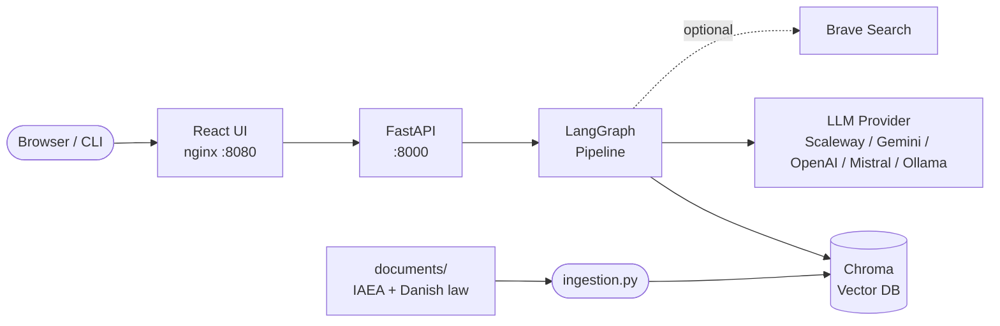
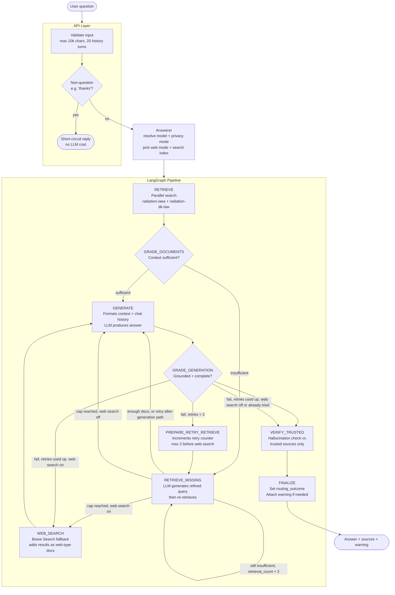
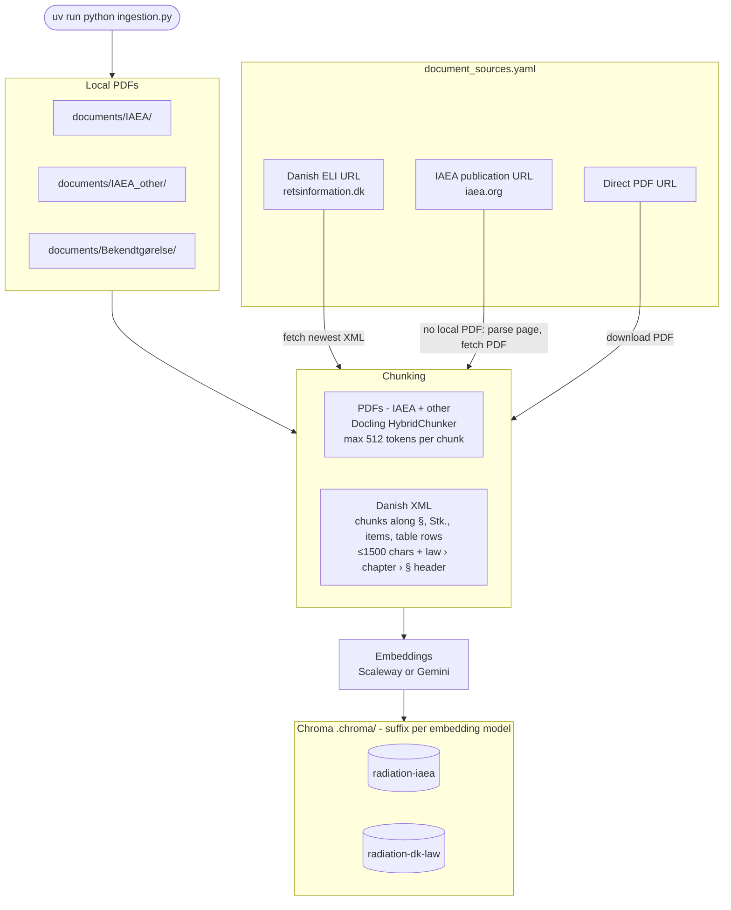
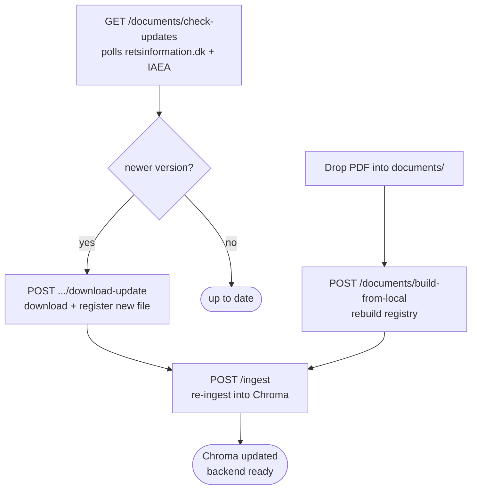
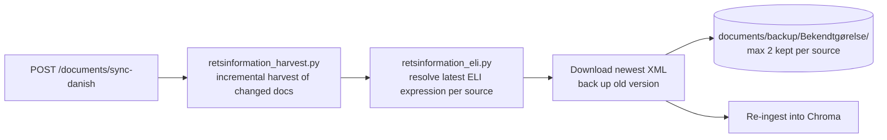
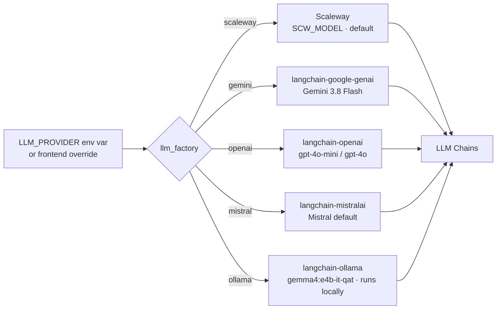

# Architecture

This document describes how the Radiation Safety RAG system is structured — from a user query arriving at the API to an answer being returned with cited sources.

---

## Overview

The system has three main layers:

1. **API** (`api/main.py`) — validates inputs, enforces rate limits, and hands the question to the Answerer (`graph/answering.py`), the one way the API and eval answer: it resolves the model, derives privacy mode, picks the web mode and the search index, and runs the graph built for that web mode.
2. **LangGraph pipeline** (`graph/`) — a stateful workflow of retrieval, grading, generation, and verification nodes.
3. **Vector database** (Chroma, `.chroma/`) — stores document chunks embedded by the configured embedding provider (Scaleway by default, Gemini optional; local embeddings in Ollama mode).

The frontend (`frontend/`) is a React/TypeScript chat UI that calls the API. Key components live in `frontend/src/components/`: `QueryForm` (question input), `QueryProgress` (progress while a query runs), `ResponseDisplay` (answer + sources + warnings), `PrivacyNoticeModal` (in-app privacy notice), `DocumentsPanel` + `DocumentListSidebar` + `DocumentUpdatesModal` (document management UI), `ModelSelector` (LLM provider picker), and `SettingsModal` (API keys, preferences).



---

## Query workflow



`WEB_SEARCH` and its edges exist only in the graph built for web mode `on` (see below); in web modes `off` and `private` a capped loop or a failed answer check goes to `GENERATE` or `VERIFY_TRUSTED` instead.

A pre-rendered, full-resolution version of this graph (built directly from `graph/graph.py`) is kept at [`architecture.svg`](../architecture.svg) / [`architecture.png`](../architecture.png) in the repo root, source [`architecture.mmd`](../architecture.mmd).

### Routing outcomes

`FINALIZE` records which path the query took as `routing_outcome`. It is not part of the `/query` response; it is counted per outcome in `GET /metrics` (`radiationsafety_query_outcomes_total`) and kept on the `Answer` returned by `graph/answering.py`:

| Outcome | Meaning |
|---|---|
| `trusted_only_verified` | Answer grounded in vector DB documents only, verified |
| `trusted_only_unverified` | Web search was never attempted, but verification against trusted sources failed |
| `web_search_unverified` | Web search was used; answer may not be fully grounded |
| `web_search_verified` | Web search used, but answer verified against trusted sources |

---

## LangGraph nodes

Each node is a Python function `(state: GraphState) -> dict` in `graph/nodes/`.

The first and subsequent retrievals share the context-sufficiency check in
`graph/sufficiency.py`: it prepares the context and interprets the model's verdict.
No usable verdict is distinct from an insufficient verdict. Each node keeps its
own gap policy: the first check clears the gap, while a later check retains its
previous gap when no verdict is available. The prompt remains in
`graph/chains/context_sufficiency_grader.py`.

| Node | File | What it does |
|---|---|---|
| `RETRIEVE` | `retrieve.py` | Parallel vector search on both Chroma collections |
| `GRADE_DOCUMENTS` | `grade_documents.py` | Asks the LLM whether the retrieved context is sufficient (what is needed, where it was found, verdict) |
| `RETRIEVE_MISSING` | `retrieve_missing.py` | LLM writes a targeted query from the context gap or the answer grader's reflection hint; re-retrieves, merges and re-checks sufficiency |
| `GENERATE` | `generate.py` | Formats context + chat history; calls generation chain |
| `GRADE_GENERATION` | `grade_generation.py` | Grades the answer part by part against the context (each supported part needs a quote the context contains); writes the reflection hint on failure |
| `PREPARE_RETRY_RETRIEVE` | *(inline in graph.py)* | Increments the retry counter before another `RETRIEVE_MISSING` pass (max 2; then web search if enabled, else the answer is shown with a warning) |
| `WEB_SEARCH` | `web_search.py` | Brave Search → appends results as extra documents |
| `VERIFY_TRUSTED` | `verify_trusted.py` | Checks the answer against the trusted (index) documents only; skipped as verified when the answer already passed grading without web results; after a web search it may also try trusted domains |
| `FINALIZE` | *(inline in graph.py)* | Sets `routing_outcome` and the user-facing warning (web results unverified, or the answer may be incomplete when grading still fails) |

Shared helpers used across nodes: `graph/search_index.py` (the search index: both Chroma collections of one embedding model, its readiness and search; ingestion only writes it), `graph/web.py` (the web search seam, Brave behind it), `graph/nodes/retrieval_common.py` (merging retrieved chunks without duplicates), `graph/i18n.py` (language-aware warning/label text), `graph/utils.py` (misc formatting helpers).

The graph is built per **web mode** (`graph.graph.build_graph`): `on` searches the web as the last resort, `off` never does because the operator switched it off (`WEB_SEARCH_ENABLED`), `private` never does because of privacy mode. The graphs for `off` and `private` have no `WEB_SEARCH` node and `VERIFY_TRUSTED` gets no web search, so they cannot reach the web. Nodes get what they depend on (the search index, the web search, the web mode) as keyword arguments when the graph is built.

---

## LLM chains

Chains are factory functions in `graph/chains/` that return a LangChain runnable.

| Chain | File | Output |
|---|---|---|
| `generation` | `generation.py` | Answer text |
| `generation_grader` | `generation_grader.py` | `{parts: [{part, status, quote}], missing_info: str}`; the pass/fail verdict is computed from the parts in code, not taken from the model |
| `context_sufficiency_grader` | `context_sufficiency_grader.py` | `{needed: str, found: str, binary_score: bool}` (interpreted by `graph/sufficiency.py`) |
| `hallucinations_grader` | `hallucinations_grader.py` | `{binary_score: bool}` |
| `missing_query_chain` | `missing_query_chain.py` | Refined retrieval query string |
| `search_query_chain` | `search_query_chain.py` | Web search query string |
| `truncate` | `truncate.py` | Formats the context for generator and graders: whole chunks with their source label; a very long context drops whole chunks, never the end of one |

---

## State

`graph/state.py` defines `GraphState` — a `TypedDict` that flows through the entire pipeline.

Key fields:

| Field | Type | Purpose |
|---|---|---|
| `question` | `str` | Current user question |
| `generation` | `str` | LLM-generated answer |
| `documents` | `list` | Retrieved + web chunks |
| `trusted_documents` | `list` | Vector DB chunks only (for verification) |
| `chat_history` | `list[tuple]` | Previous (question, answer) pairs |
| `context_sufficient` | `bool` | The context grader's verdict on the retrieved chunks |
| `reflection` | `str` | LLM hint about what was missing (from grader) |
| `generation_passed_grading` | `bool` | Verdict of `GRADE_GENERATION`, read by the routing |
| `retrieval_count` / `retry_after_generation_count` | `int` | Loop counters (max 3 retrievals; max 2 retries after a failed answer check) |
| `routing_outcome` | `str` | Final path taken through the graph |
| `retrieval_warning` | `str` | User-facing warning (language-aware) |

---

## Document ingestion



### Source catalog

`source_catalog.py` owns source registration, location/identity changes, and
fetched revisions. Uploads, ingestion, update checking, and registry rebuilding
use `SourceCatalog`; fetching, PDF/XML parsing, and embedding stay with their
existing modules. `snapshot()` reads the source list and version metadata
consistently, `register()` assigns an unused ID, `update()` preserves unrelated
metadata, and `replace_sources()` rejects discovery based on a stale snapshot.

New version writes describe obtained document contents. Discovering or confirming
a newer URL changes location/identity only; the previous revision remains current
until fetching succeeds. Ingestion records the revision during document loading,
before embedding. Existing values are retained without claiming they prove either
fetching or indexing, and the catalog does not track revisions per search index.
Version lookup retains JSON → YAML → local-file fallback precedence.

The existing `document_sources.yaml` and `document_versions.json` formats remain.
A Linux file lock coordinates threads/processes; atomic replacement prevents
partial files. A durable `document_sources.yaml.pending.json` records a combined
write before either data file is replaced. Every catalog access completes a pending
write under the lock. A failure after that record is durable can therefore finish
on the next access, even if the original caller received an error. Keep the pending
file with the catalog during recovery; do not retry registration blindly after an
ambiguous failure. Direct readers/editors outside the catalog do not participate
in this guarantee. Malformed state raises an error instead of being overwritten.

Rebuilding remains replacement: sources absent from local discovery disappear.
Discovery runs outside the lock, then compares the snapshot revision before saving,
so a concurrent upload or metadata edit causes a retryable conflict rather than a
lost edit (HTTP 409 from the rebuild endpoint). Example-file fallback is retained: registration starts an actual registry,
and location updates do not materialize an absent registry. Custom CLI output uses
its own companion lock, pending-write, and versions files.

### Key ingestion facts

- **Commands:** `uv run python ingestion.py` (full), `--dk-only` (rebuild only the Danish collection), `--reembed-from <provider>` (embed the existing chunks of that provider's collections with the configured `EMBEDDING_PROVIDER`, without re-parsing documents).
- **Collection names:** Gemini uses the plain names `radiation-iaea` / `radiation-dk-law`; Scaleway uses `-scw-<model>` suffixes (default `bge-multilingual-gemma2`); Ollama uses `-ollama`.
- **Embeddings follow `EMBEDDING_PROVIDER`** (Scaleway by default, Gemini optional), independently of the answering model; each provider/model has its own collections.
- Changing `LLM_PROVIDER` (Scaleway / Gemini / OpenAI / Mistral for *generation*) does **not** require re-ingestion.
- **PDFs are read with docling**; if it fails on its default device (e.g. a GPU held by a local model), once more on the CPU. If it fails there too, ingestion stops before any collection is emptied, unless `--allow-pypdf-fallback` / `INGEST_ALLOW_PYPDF_FALLBACK=true` lets pypdf index the plain text. Every PDF not read as usual (on the CPU, as plain text, skipped, fewer than 100 characters per page) is listed at the end of the run, in the upload message and, for an ingestion started from the Documents panel, in `GET /ingest/status` and the panel.
- Danish sources are always fetched as XML (not PDF) and updated to the newest version of the series. A registry source that cannot be fetched is listed at the end of the run with the reason and does not stop it; a Danish law is then indexed from the XML saved by its last fetch (`<id>_current.xml`).
- An IAEA registry source whose PDF (`filename_hint`) is in `documents/IAEA/` or `documents/IAEA_other/` is indexed from that file only, never also fetched: the fetch indexed the publication twice and never gave a newer edition, which has its own page and comes through the update check (`download_update_for_source` replaces the local PDF).
- Older Danish versions are kept in `documents/backup/Bekendtgørelse/` (max 2 per source).
- The Gemini collection names (`radiation-iaea`, `radiation-dk-law`) and their suffixed variants must not be renamed without re-ingesting.
- **Ollama mode** uses `bge-m3` for embeddings and stores them in separate `radiation-iaea-ollama-bge-m3` and `radiation-dk-law-ollama-bge-m3` collections. Every local embedding model gets its own pair (`-ollama-<model>`); the earlier default `nomic-embed-text` keeps `radiation-iaea-ollama` / `radiation-dk-law-ollama`.

### Updating documents

Uploaded PDFs are handled by `document_uploads.py`. The upload route validates
the request; the upload module saves the file, reads its metadata, looks up its
publication URL, indexes its chunks, registers the source, and refreshes the
search index. Registration happens only after indexing completes with at least
one chunk. Zero chunks returns an upload error (HTTP 422). An indexing failure
leaves the registry unchanged; the saved PDF and any chunks already written
remain. Registration failures also leave indexed chunks in place: uploads do
not provide transactional rollback.

The Documents panel in the UI (or the admin API) handles the update lifecycle. Ingestion reads `documents/` and `document_sources.yaml` from the backend's working directory; the Docker backend image contains neither (only `.chroma/` is mounted), so in the Docker setup rebuild the index from a checkout on the host (`uv run python ingestion.py`, then `docker compose restart backend`).



### Danish source sync

`POST /documents/sync-danish` brings every Danish Bekendtgørelse up to the newest version in one call, via `document_updates.sync_danish_legislation()` and `graph/services/`:



- `RETSINFO_API_KEY` (optional) — subscription key sent to the retsinformation.dk Harvest API for higher rate limits; the harvest works unauthenticated without it.
- `RETSINFO_RESOLVER_MODE` (optional, default `shadow`) — controls how much the ELI resolver (`retsinformation_eli.py`) is trusted relative to the legacy probe/search resolver used elsewhere in `document_updates.py`:
  - `shadow` (default): the legacy resolver stays authoritative; the ELI resolver still runs and its result is recorded as `resolution_evidence` for comparison, but never applied.
  - `guarded` / `enforce`: the ELI resolver's result is used directly whenever it resolves a URL.

---

## LLM providers

`graph/llm_factory.py` selects the LLM at runtime based on `LLM_PROVIDER`.



| Provider | `LLM_PROVIDER` value | Key required | Notes |
|---|---|---|---|
| Scaleway | `scaleway` | `SCW_SECRET_KEY` | Default; models from `SCW_MODEL` / `SCW_ALLOWED_MODELS`, embeddings `SCW_EMBED_MODEL` |
| Gemini | `gemini` | `GOOGLE_API_KEY` | Optional; also as `EMBEDDING_PROVIDER=gemini` |
| OpenAI | `openai` | `OPENAI_API_KEY` | Retrieves with `EMBEDDING_PROVIDER` |
| Mistral | `mistral` | `MISTRAL_API_KEY` | Retrieves with `EMBEDDING_PROVIDER` |
| Ollama | `ollama` | None | Fully local — see [Privacy Mode](#privacy-mode-ollama) below |

The frontend can pass API keys directly (stored in `sessionStorage`, never persisted). When this happens, LangSmith tracing is automatically disabled to prevent key leakage.

### Privacy Mode (Ollama)

When `LLM_PROVIDER=ollama`, the system uses local models and local embeddings — no data leaves your machine.

- **LLM:** `gemma4:e4b-it-qat` by default, with thinking off (configurable via `OLLAMA_MODEL`); it fits a 6 GB GPU and beat `qwen3.5:4b` on the tune set (ROADMAP, local model for privacy mode); `llama3.1:8b` spills into RAM
- **Embeddings:** `bge-m3`, multilingual (configurable via `OLLAMA_EMBED_MODEL`). Questions are embedded on the CPU so the answer model keeps the GPU; documents use the GPU while indexing.
- **Collections:** `radiation-iaea-ollama-bge-m3` and `radiation-dk-law-ollama-bge-m3` (separate from cloud collections; requires a one-time re-ingestion)
- **Context window:** `OLLAMA_NUM_CTX` (default 16384); Ollama's own 4096 would cut longer prompts
- **Never:** LangSmith tracing or web search. The Answerer answers in a graph built for web mode `private`, which has no web search to call, and switches tracing off for the whole run, retrieval threads included

Cloud and Ollama collections coexist in `.chroma/`. Switching back to a cloud provider restores the original collections without re-ingestion.

---

## API routes

| Method | Path | Auth | Description |
|---|---|---|---|
| `POST` | `/query` | Public | RAG query — main entry point |
| `GET` | `/health` | Public | Health check |
| `GET` | `/metrics` | Public | Prometheus-style counters |
| `GET` | `/config` | Public | Client-relevant config: `server_has_llm_key`, per-provider readiness (`providers`: server key present, blocking `issue`), selectable Scaleway models (`scaleway_models`), and the optional privacy-notice controller (`privacy_controller_name`, `privacy_controller_contact`) |
| `GET` | `/documents/check-updates` | Public | Check for newer document versions |
| `GET` | `/documents/source/{id}/file` | Public | Serve the local PDF for a document source |
| `POST` | `/ingest` | Admin | Trigger full re-ingestion |
| `GET` | `/ingest/status` | Public | Current ingestion status (`idle` or `running`), why the last run failed (`last_error`, or `null`) and the PDFs it did not read as usual (`pdf_problems`: `{file, problem}`) |
| `POST` | `/documents/add-pdf` | Admin | Upload and register a new PDF |
| `PATCH` | `/documents/source/{id}/url` | Admin | Update a source URL manually |
| `POST` | `/documents/source/{id}/lookup-url` | Admin | Auto-resolve newest URL for a source |
| `POST` | `/documents/source/{id}/download-update` | Admin | Download and apply the newest version |
| `POST` | `/documents/build-from-local` | Admin | Rebuild registry from local PDFs |
| `POST` | `/documents/sync-danish` | Admin | Sync all Danish sources to newest versions |

Admin routes require `X-Admin-Token` header. Without `ADMIN_TOKEN` configured, they return `503`.

---

## Saved evaluation runs

`eval/saved_runs.py` owns run-ID reservations, output serialization, report
writing, answer archives, history recording, and reopening saved runs with
their original metadata. `eval/run_eval.py` owns answering, judging, scoring,
report formatting, and subsequent dashboard generation. `eval/graph_run.py`
adapts an Answer into the record that evaluation scores and saves.

Answers are saved locally before judging. Completion writes the JSON and
Markdown reports, archives the answers of a new full run, and only then appends
history. A report or archive failure leaves history unchanged and retains any
files already written. Dashboard failure occurs after recording and does not
undo the saved run. Retrieval-only runs, rescores, and regrades do not create
new answer archives; `--no-history` creates neither history entries nor archives.

Filenames and formats are unchanged. Reopening prefers local outputs over the
gzip archive and reports corrupt files rather than silently falling back.
Original metadata comes from the first matching history entry, then the local
JSON report, or remains unknown. Regrade labels come from the latest matching
history entry. Derived run IDs do not automatically follow their lineage to
the original answers. Run-ID reservations remain scoped to the output directory.

Rescoring requires known original configuration, git commit, and matching run
identity. `SavedRuns.rescore_provenance` verifies exact original question text
for each selected saved ID before scoring or constructing a judge; full runs
also require their original answer provider and model. Missing or ambiguous
question metadata and changed questions fail with a recovery message. New
evidence, grading criteria, subsets, and ordering can change without rerunning
the graph. An empty overlap is rejected. Reading saved outputs for other uses
keeps its existing behavior.

`SavedRuns.regrade_labels` applies the same original-provenance checks before
grader calls. It selects the latest history record for labels and requires
either the original run or a direct rescore of its answers. Label question
text must match, duplicate question entries are rejected, and only boolean
verdicts contribute to answer-grader metrics. Partial rescores and null labels
still allow sufficiency grading, without inventing judge verdicts. Labels do
not fall back to local reports or older history entries.

---

## Adding a new node

1. Create `graph/nodes/my_node.py` — implement `def my_node(state: GraphState) -> dict`.
2. Export it from `graph/nodes/__init__.py`.
3. Add a name constant in `graph/consts.py`.
4. Register it in `build_graph` in `graph/graph.py`; a dependency (the search index, the web search, the web mode) is passed as a keyword argument, never read from the state or the environment:
   ```python
   workflow.add_node(MY_NODE, partial(my_node, index=index))
   workflow.add_edge(SOME_NODE, MY_NODE)
   ```

## Adding a new chain

1. Create `graph/chains/my_chain.py` — implement a `get_my_chain()` factory function.
2. Import directly from the chain file in the node(s) that use it: `from graph.chains.my_chain import get_my_chain`. Chains are **not** re-exported from `graph/chains/__init__.py` — that file is intentionally minimal.
