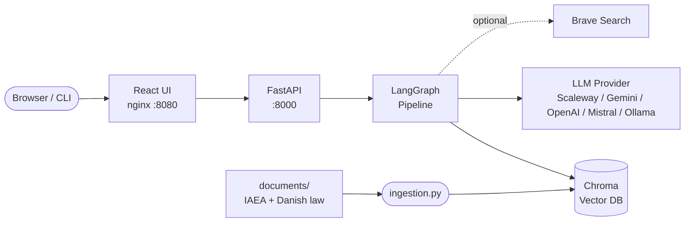
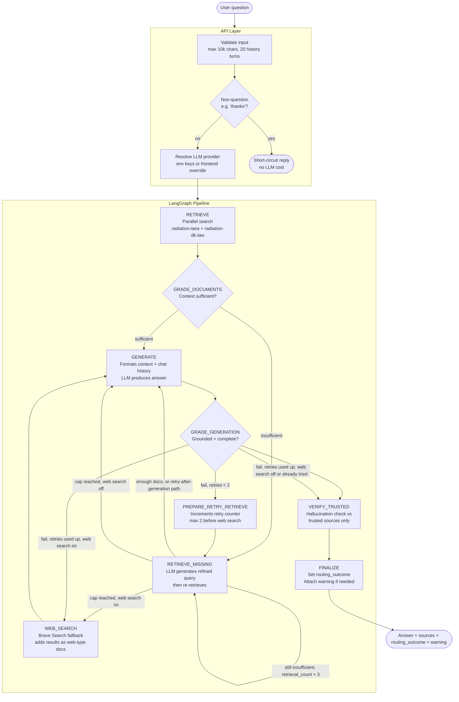
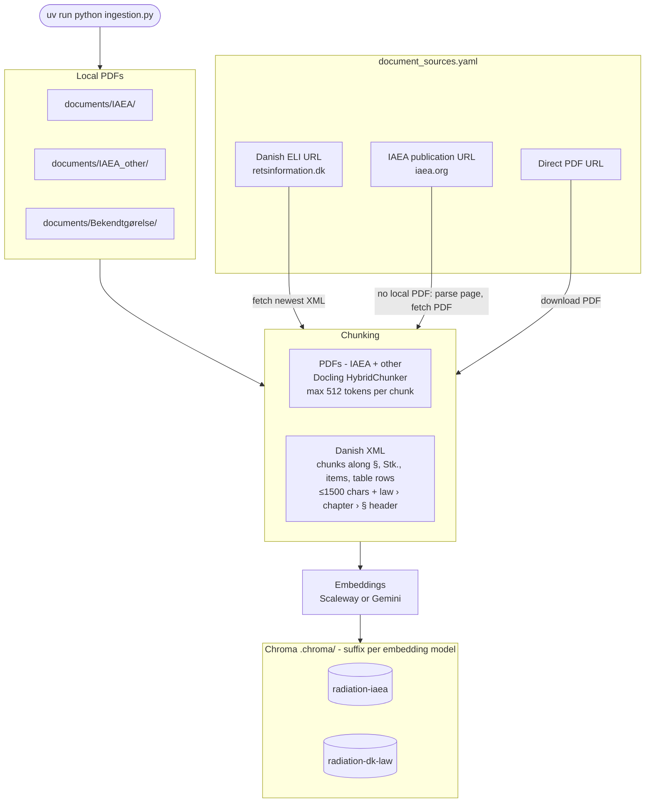
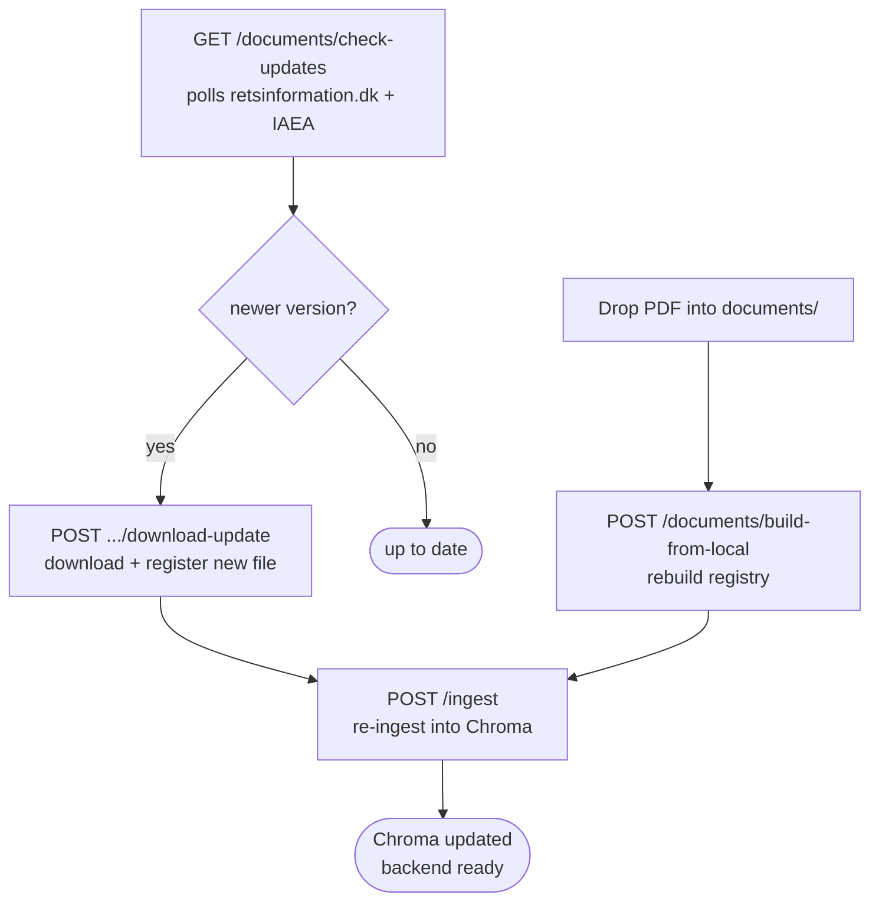
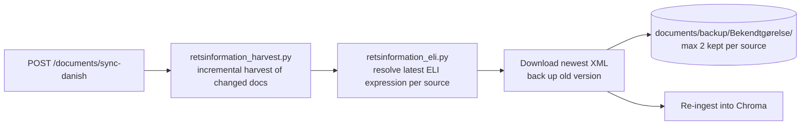
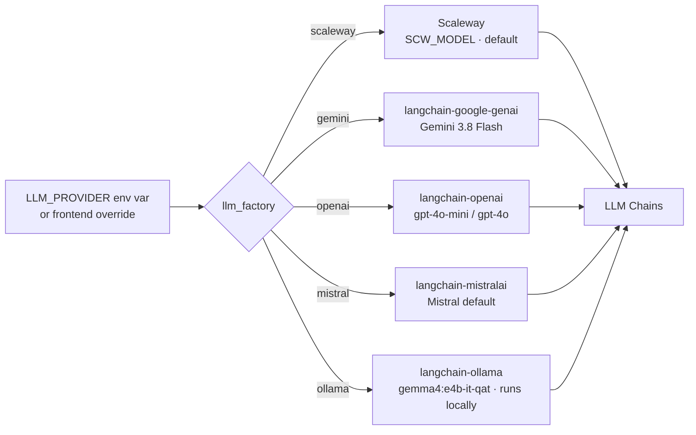

# Architecture

This document describes how the Radiation Safety RAG system is structured — from a user query arriving at the API to an answer being returned with cited sources.

---

## Overview

The system has three main layers:

1. **API** (`api/main.py`) — validates inputs, enforces rate limits, resolves LLM provider, and invokes the graph.
2. **LangGraph pipeline** (`graph/`) — a stateful workflow of retrieval, grading, generation, and verification nodes.
3. **Vector database** (Chroma, `.chroma/`) — stores document chunks embedded by the configured embedding provider (Scaleway by default, Gemini optional; local embeddings in Ollama mode).

The frontend (`frontend/`) is a React/TypeScript chat UI that calls the API. Key components live in `frontend/src/components/`: `QueryForm` (question input), `QueryProgress` (progress while a query runs), `ResponseDisplay` (answer + sources + warnings), `PrivacyNoticeModal` (in-app privacy notice), `DocumentsPanel` + `DocumentListSidebar` + `DocumentUpdatesModal` (document management UI), `ModelSelector` (LLM provider picker), and `SettingsModal` (API keys, preferences).



---

## Query workflow



A pre-rendered, full-resolution version of this graph (built directly from `graph/graph.py`) is kept at [`architecture.svg`](../architecture.svg) / [`architecture.png`](../architecture.png) in the repo root, source [`architecture.mmd`](../architecture.mmd).

### Routing outcomes

The `routing_outcome` field in the response tells you which path the query took:

| Outcome | Meaning |
|---|---|
| `trusted_only_verified` | Answer grounded in vector DB documents only, verified |
| `trusted_only_unverified` | Web search was never attempted, but verification against trusted sources failed |
| `web_search_unverified` | Web search was used; answer may not be fully grounded |
| `web_search_verified` | Web search used, but answer verified against trusted sources |

---

## LangGraph nodes

Each node is a Python function `(state: GraphState) -> dict` in `graph/nodes/`.

| Node | File | What it does |
|---|---|---|
| `RETRIEVE` | `retrieve.py` | Parallel vector search on both Chroma collections |
| `GRADE_DOCUMENTS` | `grade_documents.py` | Asks LLM: is the retrieved context sufficient? |
| `RETRIEVE_MISSING` | `retrieve_missing.py` | LLM generates a targeted query; re-retrieves |
| `GENERATE` | `generate.py` | Formats context + chat history; calls generation chain |
| `GRADE_GENERATION` | `grade_generation.py` | Checks answer is grounded and complete |
| `PREPARE_RETRY_RETRIEVE` | *(inline in graph.py)* | Increments the retry counter before another `RETRIEVE_MISSING` pass (max 2; then web search if enabled, else the answer is shown with a warning) |
| `WEB_SEARCH` | `web_search.py` | Brave Search → appends results as extra documents |
| `VERIFY_TRUSTED` | `verify_trusted.py` | Hallucination check against trusted-source docs only |
| `FINALIZE` | *(inline in graph.py)* | Sets `routing_outcome` and the user-facing warning (web results unverified, or the answer may be incomplete when grading still fails) |

Shared helpers used across nodes: `graph/nodes/retrieval_common.py` (shared Chroma retrieval logic for `RETRIEVE`/`RETRIEVE_MISSING`), `graph/i18n.py` (language-aware warning/label text), `graph/utils.py` (misc formatting helpers).

---

## LLM chains

Chains are factory functions in `graph/chains/` that return a LangChain runnable.

| Chain | File | Output |
|---|---|---|
| `generation` | `generation.py` | Answer text |
| `generation_grader` | `generation_grader.py` | `{passed: bool, missing_info: str}` |
| `context_sufficiency_grader` | `context_sufficiency_grader.py` | `{binary_score: bool}` |
| `hallucinations_grader` | `hallucinations_grader.py` | `{binary_score: bool}` |
| `missing_query_chain` | `missing_query_chain.py` | Refined retrieval query string |
| `search_query_chain` | `search_query_chain.py` | Web search query string |
| `truncate` | `truncate.py` | Truncated document list (fits token budget) |

---

## State

`graph/state.py` defines `GraphState` — a `TypedDict` that flows through the entire pipeline.

Key fields:

| Field | Type | Purpose |
|---|---|---|
| `question` | `str` | Current user question |
| `generation` | `str` | LLM-generated answer |
| `documents` | `list` | Retrieved + web chunks |
| `trusted_documents` | `list` | Vector DB chunks only (for verification) |
| `chat_history` | `list[tuple]` | Previous (question, answer) pairs |
| `web_search` | `bool` | Flag: should web search run? |
| `reflection` | `str` | LLM hint about what was missing (from grader) |
| `routing_outcome` | `str` | Final path taken through the graph |
| `retrieval_warning` | `str` | User-facing warning (language-aware) |

---

## Document ingestion



### Key ingestion facts

- **Commands:** `uv run python ingestion.py` (full), `--dk-only` (rebuild only the Danish collection), `--reembed-from <provider>` (embed the existing chunks of that provider's collections with the configured `EMBEDDING_PROVIDER`, without re-parsing documents).
- **Collection names:** Gemini uses the plain names `radiation-iaea` / `radiation-dk-law`; Scaleway uses `-scw-<model>` suffixes (default `bge-multilingual-gemma2`); Ollama uses `-ollama`.
- **Embeddings follow `EMBEDDING_PROVIDER`** (Scaleway by default, Gemini optional), independently of the answering model; each provider/model has its own collections.
- Changing `LLM_PROVIDER` (Scaleway / Gemini / OpenAI / Mistral for *generation*) does **not** require re-ingestion.
- **PDFs are read with docling**; if it fails on its default device (e.g. a GPU held by a local model), once more on the CPU. If it fails there too, ingestion stops before any collection is emptied, unless `--allow-pypdf-fallback` / `INGEST_ALLOW_PYPDF_FALLBACK=true` lets pypdf index the plain text. Every PDF not read as usual (on the CPU, as plain text, skipped, fewer than 100 characters per page) is listed at the end of the run, in the upload message and, for an ingestion started from the Documents panel, in `GET /ingest/status` and the panel.
- Danish sources are always fetched as XML (not PDF) and updated to the newest version of the series. A registry source that cannot be fetched is listed at the end of the run with the reason and does not stop it; a Danish law is then indexed from the XML saved by its last fetch (`<id>_current.xml`).
- An IAEA registry source whose PDF (`filename_hint`) is in `documents/IAEA/` or `documents/IAEA_other/` is indexed from that file only, never also fetched: the fetch indexed the publication twice and never gave a newer edition, which has its own page and comes through the update check (`download_update_for_source` replaces the local PDF).
- Older Danish versions are kept in `documents/backup/Bekendtgørelse/` (max 2 per source).
- The Gemini collection names (`radiation-iaea`, `radiation-dk-law`) and their suffixed variants must not be renamed without re-ingesting.
- **Ollama mode** uses `bge-m3` for embeddings and stores them in separate `radiation-iaea-ollama-bge-m3` and `radiation-dk-law-ollama-bge-m3` collections. Every local embedding model gets its own pair (`-ollama-<model>`); the earlier default `nomic-embed-text` keeps `radiation-iaea-ollama` / `radiation-dk-law-ollama`.

### Updating documents

The Documents panel in the UI (or the admin API) handles the update lifecycle:



### Danish source sync

`POST /documents/sync-danish` brings every Danish Bekendtgørelse up to the newest version in one call, via `document_updates.sync_danish_legislation()` and `graph/services/`:



- `RETSINFO_API_KEY` (optional) — subscription key sent to the retsinformation.dk Harvest API for higher rate limits; the harvest works unauthenticated without it.
- `RETSINFO_RESOLVER_MODE` (optional, default `shadow`) — controls how much the ELI resolver (`retsinformation_eli.py`) is trusted relative to the legacy probe/search resolver used elsewhere in `document_updates.py`:
  - `shadow` (default): the legacy resolver stays authoritative; the ELI resolver still runs and its result is recorded as `resolution_evidence` for comparison, but never applied.
  - `guarded` / `enforce`: the ELI resolver's result is used directly whenever it resolves a URL.

---

## LLM providers

`graph/llm_factory.py` selects the LLM at runtime based on `LLM_PROVIDER`.



| Provider | `LLM_PROVIDER` value | Key required | Notes |
|---|---|---|---|
| Scaleway | `scaleway` | `SCW_SECRET_KEY` | Default; models from `SCW_MODEL` / `SCW_ALLOWED_MODELS`, embeddings `SCW_EMBED_MODEL` |
| Gemini | `gemini` | `GOOGLE_API_KEY` | Optional; also as `EMBEDDING_PROVIDER=gemini` |
| OpenAI | `openai` | `OPENAI_API_KEY` | Retrieves with `EMBEDDING_PROVIDER` |
| Mistral | `mistral` | `MISTRAL_API_KEY` | Retrieves with `EMBEDDING_PROVIDER` |
| Ollama | `ollama` | None | Fully local — see [Privacy Mode](#privacy-mode-ollama) below |

The frontend can pass API keys directly (stored in `sessionStorage`, never persisted). When this happens, LangSmith tracing is automatically disabled to prevent key leakage.

### Privacy Mode (Ollama)

When `LLM_PROVIDER=ollama`, the system uses local models and local embeddings — no data leaves your machine.

- **LLM:** `gemma4:e4b-it-qat` by default, with thinking off (configurable via `OLLAMA_MODEL`); it fits a 6 GB GPU and beat `qwen3.5:4b` on the tune set (ROADMAP, local model for privacy mode); `llama3.1:8b` spills into RAM
- **Embeddings:** `bge-m3`, multilingual (configurable via `OLLAMA_EMBED_MODEL`). Questions are embedded on the CPU so the answer model keeps the GPU; documents use the GPU while indexing.
- **Collections:** `radiation-iaea-ollama-bge-m3` and `radiation-dk-law-ollama-bge-m3` (separate from cloud collections; requires a one-time re-ingestion)
- **Context window:** `OLLAMA_NUM_CTX` (default 16384); Ollama's own 4096 would cut longer prompts
- **Auto-disabled:** LangSmith tracing and web search fallback

Cloud and Ollama collections coexist in `.chroma/`. Switching back to a cloud provider restores the original collections without re-ingestion.

---

## API routes

| Method | Path | Auth | Description |
|---|---|---|---|
| `POST` | `/query` | Public | RAG query — main entry point |
| `GET` | `/health` | Public | Health check |
| `GET` | `/metrics` | Public | Prometheus-style counters |
| `GET` | `/config` | Public | Client-relevant config: `server_has_llm_key`, per-provider readiness (`providers`: server key present, blocking `issue`), selectable Scaleway models (`scaleway_models`), and the optional privacy-notice controller (`privacy_controller_name`, `privacy_controller_contact`) |
| `GET` | `/documents/check-updates` | Public | Check for newer document versions |
| `GET` | `/documents/source/{id}/file` | Public | Serve the local PDF for a document source |
| `POST` | `/ingest` | Admin | Trigger full re-ingestion |
| `GET` | `/ingest/status` | Public | Current ingestion status (`idle` or `running`), why the last run failed (`last_error`, or `null`) and the PDFs it did not read as usual (`pdf_problems`: `{file, problem}`) |
| `POST` | `/documents/add-pdf` | Admin | Upload and register a new PDF |
| `PATCH` | `/documents/source/{id}/url` | Admin | Update a source URL manually |
| `POST` | `/documents/source/{id}/lookup-url` | Admin | Auto-resolve newest URL for a source |
| `POST` | `/documents/source/{id}/download-update` | Admin | Download and apply the newest version |
| `POST` | `/documents/build-from-local` | Admin | Rebuild registry from local PDFs |
| `POST` | `/documents/sync-danish` | Admin | Sync all Danish sources to newest versions |

Admin routes require `X-Admin-Token` header. Without `ADMIN_TOKEN` configured, they return `503`.

---

## Adding a new node

1. Create `graph/nodes/my_node.py` — implement `def my_node(state: GraphState) -> dict`.
2. Export it from `graph/nodes/__init__.py`.
3. Add a name constant in `graph/consts.py`.
4. Register in `graph/graph.py`:
   ```python
   workflow.add_node(MY_NODE, my_node)
   workflow.add_edge(SOME_NODE, MY_NODE)
   ```

## Adding a new chain

1. Create `graph/chains/my_chain.py` — implement a `get_my_chain()` factory function.
2. Import directly from the chain file in the node(s) that use it: `from graph.chains.my_chain import get_my_chain`. Chains are **not** re-exported from `graph/chains/__init__.py` — that file is intentionally minimal.
